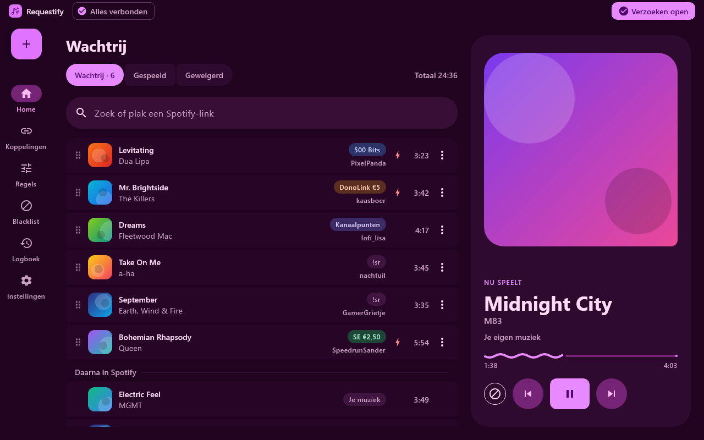
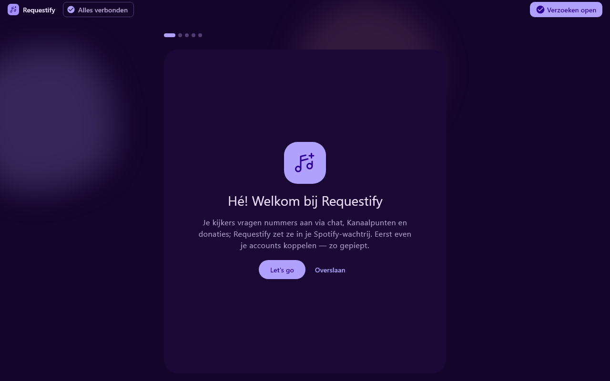
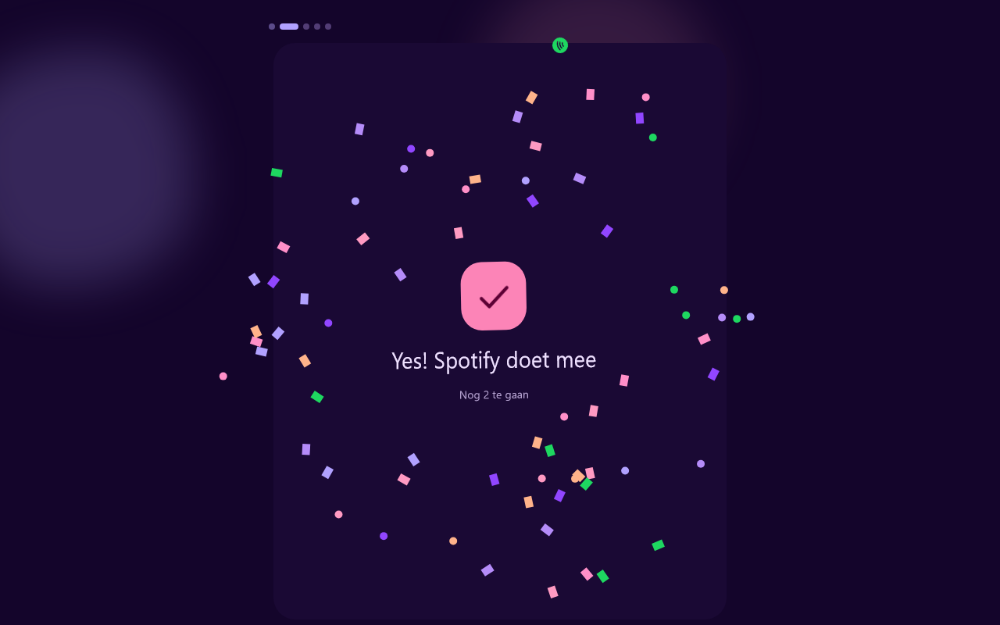
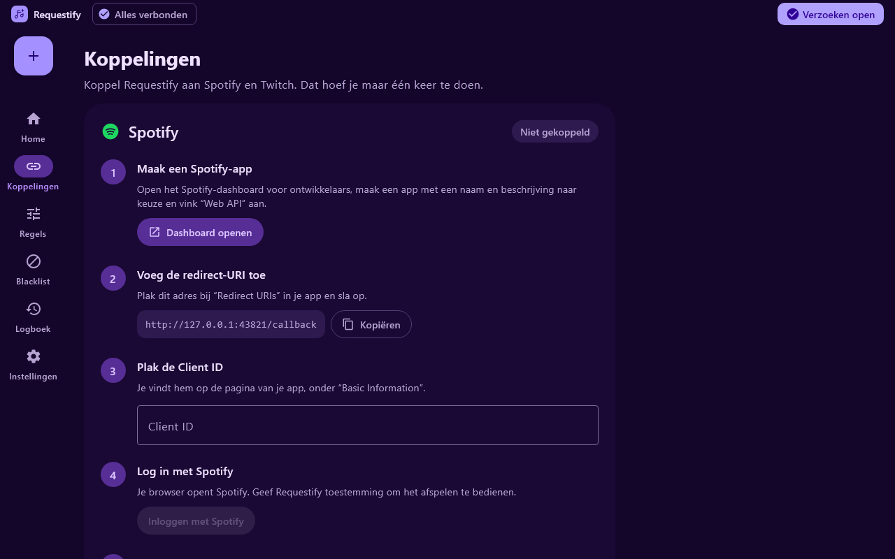
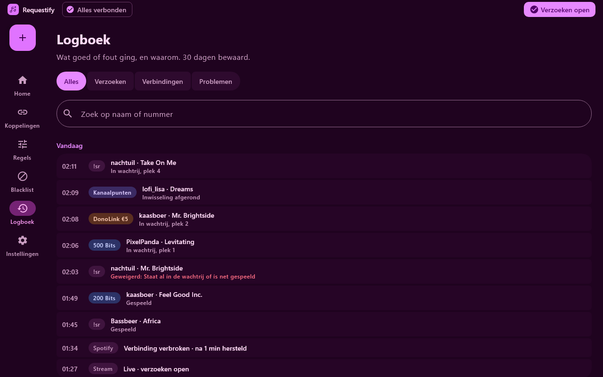
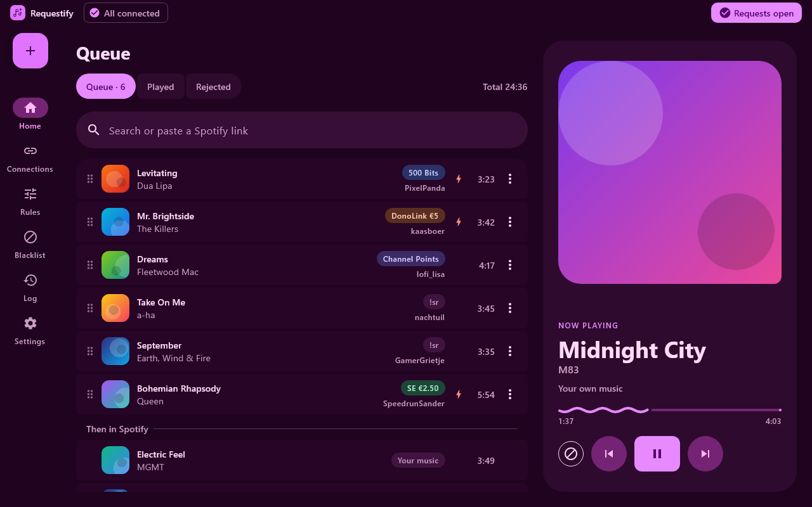
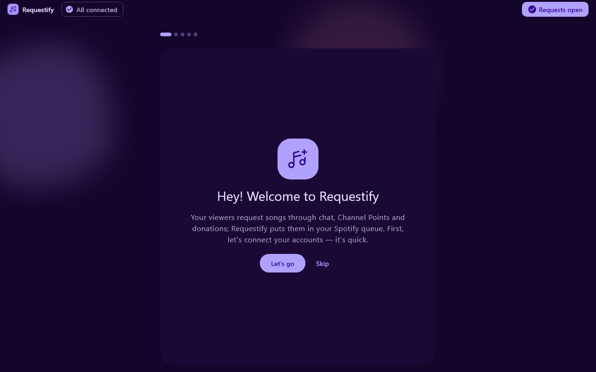
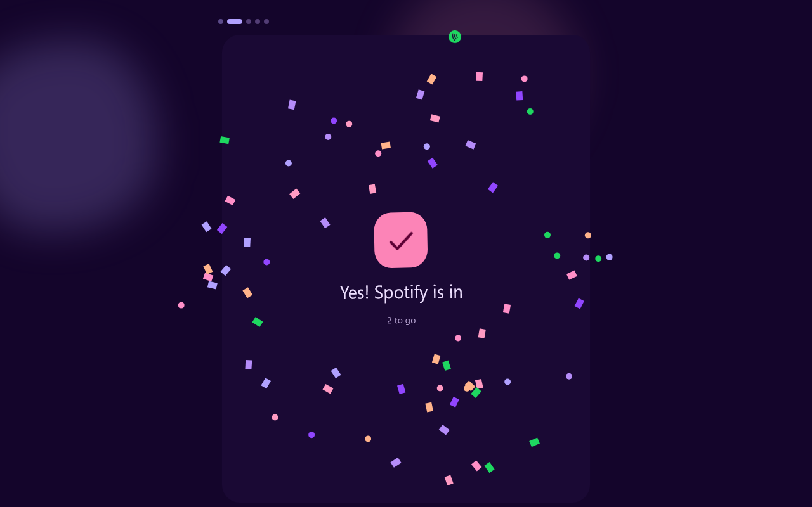
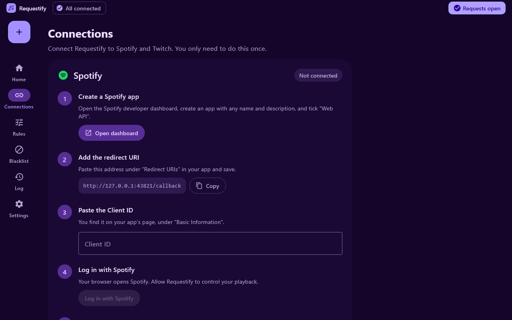
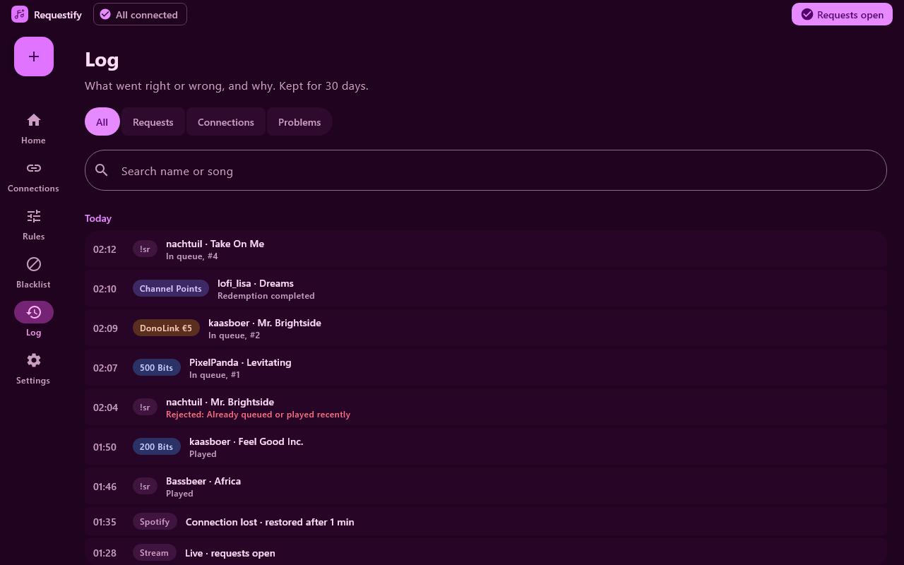

# Requestify

[Nederlands](#nederlands) · [English](#english)

## Nederlands

Requestify is een Windows-app voor streamers. Kijkers vragen nummers aan via de Twitch-chat, Kanaalpunten en donaties
(StreamElements of DonoLink), en Requestify zet ze in je Spotify-wachtrij. Jij houdt het overzicht: wachtrij, regels,
blacklist en een logboek van alles wat er binnenkwam. Gratis en open source (MIT).

- **Verzoeken van overal:** de Twitch-chat (`!sr`), Kanaalpunten, Bits en donaties via StreamElements of DonoLink.
- **Jouw regels:** een maximum in de wachtrij en per kijker, een wachttijd, lengte, geen dubbele of expliciete nummers.
  Betaalde verzoeken kunnen voorgaan en slaan de limieten over.
- **Een blacklist** voor nummers, artiesten en kijkers.
- **Vanzelf open en dicht:** verzoeken gaan open als je live gaat en dicht als je stopt.
- **Een logboek** van 30 dagen: wat goed of fout ging, en waarom.

### Installeren

1. **Eerst even checken: Slimme app-beheer** (alleen Windows 11). Open *Windows-beveiliging* → *App- en browserbeheer* →
   *Slimme app-beheer*. Staat dat op **Aan**, dan blokkeert Windows Requestify, omdat het nog niet ondertekend is. Staat
   het op **Uit** of **Evaluatie**, dan kun je verder. Staat het aan? Laat het even weten.
2. Download **Requestify-Setup-*versie*.exe** bij de [nieuwste release](https://github.com/DIMENTS/Requestify/releases/latest).
3. Open het bestand. Windows laat eerst **"Windows heeft uw pc beschermd"** zien: klik op **Meer info** en daarna op
   **Toch uitvoeren**. Dat komt doordat Requestify nog niet ondertekend is, en gebeurt alleen bij deze eerste installatie.
4. Requestify installeert voor jouw Windows-gebruiker, zonder beheerdersvraag, en start meteen met een welkomstwizard
   die je helpt Spotify, Twitch en je donaties te koppelen.

### Daarna

- Requestify start met Windows en wacht in het systeemvak tot je live gaat.
- Het werkt zichzelf bij via GitHub, maar **nooit tijdens een stream**: een nieuwe versie wordt geïnstalleerd bij de
  volgende start, of als je offline op **Nu bijwerken** klikt (*Instellingen* → *Over Requestify*).
- Verwijderen gaat via *Windows-instellingen* → *Apps*. Je koppelingen en instellingen blijven bewaard, dus opnieuw
  installeren zet alles terug.

### Zo ziet het eruit

  
  

De welkomstwizard helpt je bij de eerste start Spotify, Twitch en je donaties te koppelen: één kaart tegelijk, met een
feestje bij elke koppeling.

  
  

*Koppelingen* legt elke stap uit, en het *Logboek* laat zien wat er met elk verzoek gebeurde. De kijkers en
albumhoesjes in deze screenshots zijn verzonnen.

## English

Requestify is a Windows app for streamers. Viewers request songs through Twitch chat, Channel Points and donations
(StreamElements or DonoLink), and Requestify puts them in your Spotify queue. You stay in control: queue, rules,
blacklist and a log of everything that came in. Free and open source (MIT).

- **Requests from everywhere:** Twitch chat (`!sr`), Channel Points, Bits and donations through StreamElements or
  DonoLink.
- **Your rules:** a maximum in the queue and per viewer, a cooldown, length, no duplicate or explicit songs. Paid
  requests can go first and skip the limits.
- **A blacklist** for songs, artists and viewers.
- **Opens and closes by itself:** requests open when you go live and close when you stop.
- **A log** of 30 days: what went right or wrong, and why.

### Installing

1. **First, check Smart App Control** (Windows 11 only). Open *Windows Security* → *App & browser control* →
   *Smart App Control*. If it is **On**, Windows blocks Requestify, because it is not signed yet. If it is **Off** or
   **Evaluation**, you're good to go. Is it on? Let us know.
2. Download **Requestify-Setup-*version*.exe** from the [latest release](https://github.com/DIMENTS/Requestify/releases/latest).
3. Open it. Windows first shows **"Windows protected your PC"**: click **More info**, then **Run anyway**. That is
   because Requestify is not signed yet, and only happens on this first install.
4. Requestify installs for your Windows user, without an admin prompt, and starts with a welcome wizard that helps you
   connect Spotify, Twitch and your donations.

### Afterwards

- Requestify starts with Windows and waits in the system tray until you go live.
- It updates itself from GitHub, but **never during a stream**: a new version installs at the next start, or when you
  click **Update now** while offline (*Settings* → *About Requestify*).
- Uninstall through *Windows Settings* → *Apps*. Your connections and settings are kept, so reinstalling brings
  everything back.

### What it looks like

  
  

At the first start, the welcome wizard helps you connect Spotify, Twitch and your donations: one card at a time, with
a little party for every connection.

  
  

*Connections* explains every step, and the *Log* shows what happened to each request. The viewers and album covers in
these screenshots are made up.

---

Voor ontwikkelaars · For developers: [docs/development.md](docs/development.md)
